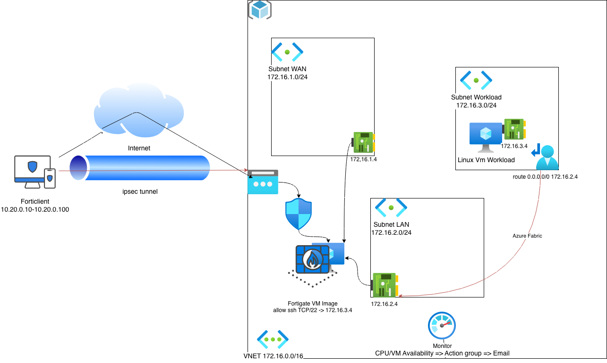
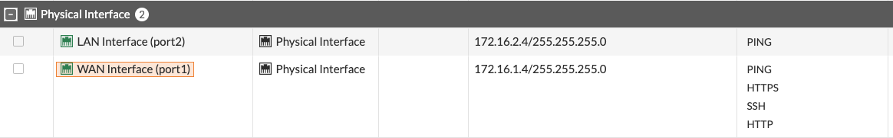
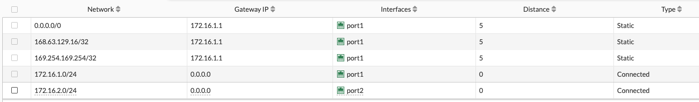
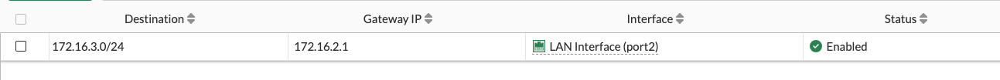
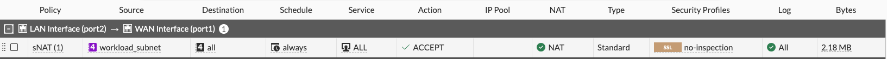
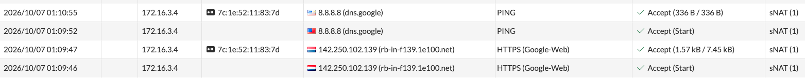

# FortiGate Azure p2s VPN
## Overview
This lab deploys IPSec VPN with FortiGate-VM in Microsoft Azure as a Network Virtual Appliance (NVA), with a private Linux workload behind it.

Initially the configuration has been validated manually: Azure resources, Fortigage configuration and forticlient remote access.
The validated configuration has been then automated using Terraform with separate modules for Azure and FortiOS.

Validated capabilities include workload Internet access through FortiGate, FortiClient IKEv2 remote access to the private Linux workload over SSH, firewall traffic logging (including implicit denies), and Azure Monitor alerts with email notifications.

The environment can be deployed and destroyed on demand.
Initial deployment uses two Terraform applies because the FortiOS resources require Fortigate API token wich is ready onlu after VM is created and available.

---

## Target Architecture
```text

                         Internet
                            |
                     Azure Public IP
                            |
                  FortiGate port1 (WAN)

                     172.16.1.4/24
                            |
                       [ FortiGate ]
                            |
                  FortiGate port2 (LAN)

                     172.16.2.4/24
                            |
                      Azure Fabric
                            |
                 Workload subnet / UDR

                     172.16.3.0/24
                            |
                     Linux workload

                       172.16.3.4

```

The validated remote-access flow is:

```text

 FortiClient (macos/windows)

       |
       | IPsec
       v
    Internet
       |
       v
 Azure Public IP
       |
       v
 FortiGate port1
       |
       | IPsec termination
       v
   FortiGate
       |
       v
 Azure Fabric
       |
       v
 Workload subnet
       |
       v
 Linux VM

 172.16.3.4

```
Below a visual reprezentation of the topology


**---**

## Azure Network
The lab uses the following address space:

| Component | Address |

| --- | --- |

| VNet | `172.16.0.0/16` |
| WAN subnet | `172.16.1.0/24` |
| FortiGate port1 | `172.16.1.4` |
| LAN / transit subnet | `172.16.2.0/24` |
| FortiGate port2 | `172.16.2.4` |
| Workload subnet | `172.16.3.0/24` |
| Linux workload | `172.16.3.4` |
| VPN client pool | `10.20.0.0/24` |

The FortiGate WAN NIC has an Azure Public IP associated with it.

Both FortiGate NICs have Azure IP forwarding enabled.

The Linux workload has no Public IP.

---

## FortiGate VM
FortiGate is deployed with Terraform using the Azure Marketplace image.

This allows the Azure infrastructure, NICs, IP addresses and VM configuration to remain under Terraform control.

### Marketplace Image
```hcl

source_image_reference {
  publisher = "fortinet"
  offer     = "fortinet_fortigate-vm"
  sku       = "fortinet_fg-vm_payg_76_g2"
  version   = "latest"
}
plan {
  name      = "fortinet_fg-vm_payg_76_g2"
  publisher = "fortinet"
  product   = "fortinet_fortigate-vm"
}

```

The image is:

```text

FortiGate PAYG
FortiOS 7.6
Generation 2

```

In order to balance the cost with Fortinet requirements, the selected VM size is:

```text
Standard_B1s
```

### FortiGate Interfaces
FortiGate sees the two Azure NICs correctly:



Their roles are:

```text
port1 -> WAN
port2 -> LAN / Azure transit
```

`port1` is also currently used for FortiGate management (ssh, http/https allowed).

---

## FortiGate Azure Authentication
The FortiGate VM is deployed using `azurerm_linux_virtual_machine`.

Password authentication must be explicitly enabled:

```hcl

admin_username                  = "localadmin"
admin_password                  = var.fortigate_admin_password
disable_password_authentication = false

```

`disable_password_authentication` defaults to `true` for the Terraform Azure Linux VM resource.

Without explicitly setting it to `false`, password authentication does not work even when `admin_password` is supplied.

The FortiGate GUI can be accessed over HTTPS on TCP/8443 using:

```text

Username: localadmin
Password: \<Terraform configured password>

```

---

## Network Security
An Azure Network Security Group protects the FortiGate WAN side.

During IPsec VPN configuration on FortiOS 7.6.7, the FortiGate HTTPS management interface became inaccessible on TCP/443.

FortiOS 7.6.x supports IKE-over-TCP and may use TCP/443 as its default IKE-over-TCP listening port. This can conflict with HTTPS administration when both services use the same port.
To avoid the potential port conflict, HTTPS administration was moved to TCP/8443:

```text
TCP/8443
```
and kept 
SSH may optionally be enabled:

```text
TCP/22
```

For the working remote-access IPsec VPN, the WAN NSG permits:

```text
UDP/500   IKE
UDP/4500  IPsec NAT-T
```

Management ports should ultimately be restricted to trusted source IP addresses rather than exposed to all Internet sources.

---

# Workload VM
The Linux workload is deployed into:

```text
172.16.3.0/24
```

Current workload IP:

```text
172.16.3.4
```

This VM has no public IP address.

---

## Linux Routing
The Linux VM receives its network configuration from Azure DHCP.

The guest routing table currently contains:

```text
default via 172.16.3.1 dev eth0 proto dhcp src 172.16.3.4 metric 100
168.63.129.16 via 172.16.3.1 dev eth0 proto dhcp src 172.16.3.4 metric 100
169.254.169.254 via 172.16.3.1 dev eth0 proto dhcp src 172.16.3.4 metric 100
172.16.3.0/24 dev eth0 proto kernel scope link src 172.16.3.4 metric 100
172.16.3.1 dev eth0 proto dhcp scope link src 172.16.3.4 metric 100
```

From the Linux VM perspective, its default gateway is therefore:

```text
172.16.3.1
```

This is the Azure virtual gateway for the subnet.

The guest only knows:

```text
Linux

172.16.3.4
    |
    v
172.16.3.1

Azure virtual gateway

```

Azure Fabric applies the User Defined Route after receiving the packet from the VM.

---

# Azure User Defined Route
The route table associated with the workload subnet contains:

```text
Destination:   0.0.0.0/0
Next Hop Type: Virtual Appliance
Next Hop IP:   172.16.2.4
```

This forces workload traffic toward FortiGate.

The resulting path is:

```text

Linux
172.16.3.4
    |
    | default gateway
    v
172.16.3.1

Azure Fabric
    |
    | UDR
    | 0.0.0.0/0
    v
172.16.2.4
FortiGate port2
```

---

# FortiGate Internal Routing
Initially, the FortiGate routing table contained:



**---**

## LAN vs Transit Network
This is an important difference compared with a traditional on-premises firewall deployment.

In a traditional environment, the FortiGate LAN interface might be directly connected to the server LAN:

```text
FortiGate LAN
192.168.10.1/24
       |
       +--- Server
            192.168.10.10

```

The entire server network is directly connected to the firewall.

In this Azure design, `port2` is connected to a dedicated transit subnet:

```text
FortiGate
port2
172.16.2.4/24
      |
      | Transit subnet
      | 172.16.2.0/24
      |
 Azure Fabric
      |
      +-------------------
      |
 Workload subnet

 172.16.3.0/24
      |
 Linux
 172.16.3.4
```

So:

```text
172.16.2.0/24
```
is not the workload LAN.

It is the transit network between FortiGate and Azure Fabric. The actual workload network is:

```text
172.16.3.0/24
```
---

# FortiGate Return Route
Because `172.16.3.0/24` is not directly connected, FortiGate requires a route back to the workload subnet.

The Azure gateway for the FortiGate LAN/transit subnet is:

```text
172.16.2.1
```
The required route is:

```text

172.16.3.0/24
    |
    v
172.16.2.1
    |
    v
port2
```

FortiGate configuration:

```text
config router static
    edit 0
        set dst 172.16.3.0 255.255.255.0
        set gateway 172.16.2.1
        set device "port2"
    next
end
```

or in GUI:



Without this route, FortiGate uses its default route for traffic returning to `172.16.3.4`:

```text
0.0.0.0/0
    -> 172.16.1.1
    -> port1
```
which sends the return traffic in the wrong direction.

After adding the route, connectivity from the Linux VM to the FortiGate LAN interface is successfully validated:

```text
172.16.3.4 (Linux VM)
    |
    v
172.16.2.4 (LAN - Fortigate)
```
---

# FortiGate Workload Address Object
The workload network is represented by a dedicated FortiGate address object.

```text
config firewall address
    edit "workload-subnet"
        set subnet 172.16.3.0 255.255.255.0
        set associated-interface "port2"
    next
end

```

This represents:

```text
workload-subnet = 172.16.3.0/24
```

It is important not to use the automatically generated:

```text
port2 address
```

object for workload traffic.

The `port2 address` object represents the directly connected network:

```text
172.16.2.0/24
```

but the actual workload traffic originates from:

```text
172.16.3.0/24
```

---

# FortiGate Internet Policy
To allow workload traffic to access the Internet, a firewall policy is configured from:

```text
port2 -> port1
```

The logical policy is:

```text
Incoming Interface: port2
Outgoing Interface: port1
Source:
    workload-subnet
    172.16.3.0/24
Destination:
    all
Schedule:
    always
Service:
    ALL
Action:
    ACCEPT
NAT:
    ENABLED
```

Equivalent FortiGate configuration:

```text

config firewall policy
    edit 1
        set name "sNAT"
        set srcintf "port2"
        set dstintf "port1"
        set action accept
        set srcaddr "workload-subnet"
        set dstaddr "all"
        set schedule "always"
        set service "ALL"
        set logtraffic all
        set logtraffic-start enable
        set nat enable
        set port-preserve disable
    next
end
```



SNAT uses the FortiGate outgoing WAN interface address.
Conceptually:

```text

172.16.3.4 Linux
    |
    v
FortiGate port2 172.16.2.4
    |
    | SNAT
    | 172.16.3.4 -> 172.16.1.4
    v
FortiGate port1 172.16.1.4
    |
    v
Azure Public IP
    |
    v
Internet
```

---

# Validated Workload Data Path
The following complete data path is functional:

```text
Linux workload (ping 8.8.8.8, curl https\://google.com)
172.16.3.4
       |
       | Linux default route
       | gateway 172.16.3.1
       v
Azure Fabric
       |
       | UDR
       | 0.0.0.0/0
       | Virtual Appliance
       | 172.16.2.4
       v
FortiGate port2 172.16.2.4
       |
       | Firewall Policy
       | workload-subnet -> all
       | ACCEPT
       | SNAT enabled
       v
FortiGate port1 172.16.1.4
       |
       | Azure Public IP mapping
       v
Internet

```
The return path is:

```text
Internet
    |
    v
FortiGate port1 172.16.1.4
    |
    | FortiGate route
    | 172.16.3.0/24
    | via 172.16.2.1
    v
FortiGate port2 172.16.2.4
    |
    v
Azure Fabric
    |
    v
Linux workload 172.16.3.4
```

visible also from captured traffic:



---

# Current Status

## Azure infrastructure — managed by Terraform (`module.azure`)

- Resource Group, VNet, WAN/transit/workload subnets, NICs, Public IP, NSG and workload UDR
- FortiGate PAYG VM and private Linux workload VM
- Azure Monitor CPU and VM availability metric alerts, linked to an email Action Group

## FortiOS — managed by Terraform (`module.fortinet`)

- Return route to `172.16.3.0/24` via `172.16.2.1` on `port2`
- Workload address object and `port2 -> port1` Internet policy with SNAT
- IKEv2 dial-up IPsec VPN with FortiClient EAP authentication and split tunneling
- VPN-to-workload policy allowing SSH, with NAT disabled and traffic logging enabled
- Implicit deny logging enabled using `fortios_log_setting`
- FortiGate HTTPS management on TCP/8443
---

# Remote Access IPsec VPN — Validated

## VPN architecture

```text
Mac / FortiClient (10.20.0.10)
          |
          | IPsec tunnel (phase1)
          v
Azure Public IP -> FortiGate port1 (172.16.1.4)
                         |
                         | IPsec termination + firewall policy
                         v
                  FortiGate port2 (172.16.2.4)
                         |
                         | Azure Fabric; next hop 172.16.2.1
                         v
                  Linux VM (172.16.3.4)
```

The tunnel is a FortiClient dialup IPsec tunnel on `port1`. The VPN uses **IPsec tunnel mode**; this is independent of split tunneling.

The WAN NSG allows UDP/500 (IKE) and UDP/4500 (NAT-T). HTTPS administration is on TCP/8443. Restrict management access to trusted source IPs and retain a recovery path before removing public access.

## VPN address pool and workload policy

The VPN client pool is `10.20.0.0/24`; the connected Mac received `10.20.0.10`. The workload is `172.16.3.4` in `172.16.3.0/24`.

A VPN-to-workload policy was required:

```text
Incoming interface: phase1
Outgoing interface: port2
Source:             VPN client pool (10.20.0.0/24)
Destination:        workload-subnet (172.16.3.0/24)
Action:             ACCEPT
Service:            SSH in the Terraform-managed policy (PING was used during initial manual tests)
NAT:                DISABLED
```

During initial troubleshooting, the source was temporarily set to `all`. This was a diagnostic step, not a recommended production policy. Check the Terraform-managed address objects and policy to confirm the current source restriction.

Example address object and policy adjustment (use the actual policy ID):

```text
config firewall address
    edit "vpn-client-pool"
        set subnet 10.20.0.0 255.255.255.0
    next
end

config firewall policy
    edit <VPN_TO_WORKLOAD_POLICY_ID>
        set srcaddr "vpn-client-pool"
        set nat disable
    next
end
```

The FortiGate return route to the workload is `172.16.3.0/24 via 172.16.2.1 port2`. For the reply to `10.20.0.10`, the workload subnet's Azure UDR (`0.0.0.0/0 -> 172.16.2.4`) already directs traffic back to FortiGate. No VPN-to-workload SNAT is needed.

## Troubleshooting — from failed ping to working traffic

**Initial Mac tests (before fixing the policy):**

```text
ping 172.16.1.4   # success: 3 received, 0% loss
ping 172.16.2.4   # timeout during initial test
ping 172.16.3.4   # timeout during initial test
```

The ping to `172.16.2.4` targets FortiGate itself (*local-in*); it is not equivalent to forwarded traffic toward the workload. Its initial timeout was not separately diagnosed or resolved in these tests.

The packet sniffer proved that IPsec packets were received and decapsulated:

```text
diagnose sniffer packet any 'icmp and host 172.16.3.4' 4 0 a

phase1 in 10.20.0.10 -> 172.16.3.4: icmp: echo request
```

There was no corresponding `port2 out` packet at that stage. The decisive flow debug was:

```text
received a packet ... 10.20.0.10 -> 172.16.3.4 ... from phase1
src ip 10.20.0.10 match selector range 10.20.0.10-10.20.0.10
find a route: gw-172.16.2.1 via port2
Denied by forward policy check (policy 0)
```

**Interpretation:** IPsec decapsulation and the FortiGate route were correct, but no matching forward firewall policy allowed `phase1 -> port2`. `policy 0` is the implicit deny. After adding the VPN-to-workload policy without SNAT, ping to `172.16.3.4` succeeded.

Example successful output:

```text
64 bytes from 172.16.3.4: icmp_seq=0 ttl=63 time=47.545 ms
64 bytes from 172.16.3.4: icmp_seq=1 ttl=63 time=68.572 ms
64 bytes from 172.16.3.4: icmp_seq=2 ttl=63 time=209.993 ms
```

SSH to the private Linux workload was also validated; the Linux prompt was:

```text
localadmin@vm-fortigate-dev:~$
```

SSH to FortiGate itself was independently validated using `ssh -l localadmin 172.16.1.4`, which produces the FortiOS prompt `nva-fortigate-dev #`. These are different endpoints.


## Split tunneling — verified on macOS

The initial route lookup used the VPN interface `utun5` for the default route. After configuring split tunneling and reconnecting FortiClient, the routes became:

```text
route -n get 172.16.3.4
  destination: 172.16.3.0
  mask:        255.255.255.0
  gateway:     10.20.0.10
  interface:   utun5

route -n get 8.8.8.8
  destination: default
  gateway:     192.168.88.1
  interface:   en0
```

This confirms that workload traffic uses IPsec while normal Internet traffic uses the Mac's local gateway. SSH to the Linux VM continued to work after the change.

To inspect the FortiGate phase-1 split tunnel settings:

```text
show vpn ipsec phase1-interface phase1
```

The split include network is `172.16.3.0/24`. Phase 1 and Phase 2 are now defined in the FortiOS Terraform module. Consult the Terraform resources for the authoritative configuration.

## Management HTTPS on TCP/8443

The FortiGate management HTTPS port was changed manually:

```text
config system global
    set admin-sport 8443
end
```

`port1` allows HTTPS management (`set allowaccess ping https ssh http`). Azure NSG was updated to permit TCP/8443. Browser access to `https://<FORTIGATE_PUBLIC_IP>:8443` was subsequently validated. The initial connection failure was transient or otherwise undiagnosed; the available evidence does not establish a root cause.

The sniffer captured a successful external TCP handshake to `172.16.1.4:8443`, but that source was not confirmed to be the administrator. This reinforces the need to restrict the management NSG rule to trusted sources.

---

# Final Lab Goal
The end-to-end data path has been validated:

```text
Mac/Linux/Windows
 | FortiClient
 | Source: 10.20.0.x
 |
 | IPsec tunnel
 v
Internet
 |
 v
Azure Public IP
 |
 v
FortiGate port1 172.16.1.4
 |
 | IPsec termination
 | Authentication
 | Firewall policy
 |
 v
FortiGate port2 172.16.2.4
 |
 | Azure routing
 v
Azure Fabric
 |
 v
Workload subnet
172.16.3.0/24
 |
 v
Linux VM 172.16.3.4
```

---

# Terraform Deployment and Lifecycle

The project uses two modules:

```text
modules/
  azure/# azurerm: network, VMs, routing, monitoring and email Action Group
  fortinet/# fortinetdev/fortios: routes, policies, VPN and logging
```

The root module calls `module.azure` and `module.fortinet`. The Fortinet module depends on the Azure module so that the FortiGate VM is created before its API is configured.

## Initial deployment (two phases)

1. Configure the required Terraform variables and credentials. Keep passwords, pre-shared keys and API tokens out of version control.
2. Deploy Azure resources first:

   ```bash
   terraform init
   terraform apply -target=module.azure
   ```
3. After Fortigate is reachable on `https://<FORTIGATE_PUBLIC_IP>:443` https management port must be switched to 8443.
4. Then the device is reachable on `https://<FORTIGATE_PUBLIC_IP>:8443`, create a FortiOS REST API administrator/token manually and provide the token to the FortiOS provider using the project's existing variable or credential mechanism.
5. Deploy the remaining configuration:
   ```bash
   terraform apply
   ```

The targeted apply is a deliberate **bootstrap exception**, not the normal day-to-day workflow. Subsequent changes use a standard full plan/apply:

```bash
terraform fmt -recursive
terraform validate
terraform plan
terraform apply
terraform plan   # expected: No changes
```

## Destroy and recreate

```bash
terraform destroy
```
Even if apply required two steps, due of using depends-on attributes on the fortinet module definition, destroy operation can be performed in one shot. Pay attention to destroy all resources after lab is tested as leaving them you might be charged with additional costs.

## FortiOS VPN configuration

The managed FortiClient tunnel uses IKEv2, PSK and EAP user authentication, a dynamic dial-up Phase 1 interface (`phase1`), Phase 2 configuration, and split tunneling for `172.16.3.0/24`. The client address pool is configured from `10.20.0.10` through `10.20.0.100` (within `10.20.0.0/24`). The VPN firewall policy permits SSH to the Linux workload without SNAT.

A useful troubleshooting lesson: a missing policy on the VPN interface prevented successful negotiation, and the EAP identity setting had to be configured as `send-request` to complete authentication with the tested macOS FortiClient.

---

# Firewall Logging

FortiOS logging is managed by Terraform in `modules/fortinet`:

```hcl
resource "fortios_log_setting" "logging" {
  fwpolicy_implicit_log = "enable"
}
```

- The VPN-to-workload SSH policy logs allowed traffic (`logtraffic = "all"`).
- Implicit deny logging records traffic rejected by policy 0; a test HTTP connection to `172.16.3.4:80` was denied and appeared in the FortiGate traffic logs.
- VPN events can be inspected in **Log & Report → System Events → VPN**; traffic events are available in **Log & Report → Forward Traffic**.

This setting is part of the Terraform-managed configuration and should persist across lab recreation.

---

# Azure Monitor and Email Notifications

The Azure module manages two metric alerts and one Action Group:

| Resource | Name | Condition | Severity |
| --- | --- | --- | --- |
| CPU metric alert | `alert-fortigate-high-cpu` | `Percentage CPU` average > 80% over 5 minutes | 2 |
| Availability metric alert | `alert-fortigate-unavailable` | `VmAvailabilityMetric` average < 1 over 5 minutes | 1 |
| Action Group | `ag-fortigate-alerts` | Email receiver configured through `var.alert_email` | — |

Both metric alerts evaluate every minute and reference the same Action Group. The recipient is supplied through the Terraform variable `alert_email` (passed from the root module to `module.azure`). Use an appropriate non-committed variable file or other approved variable mechanism for the email address.

`VmAvailabilityMetric` reflects Azure platform-reported VM availability; it is **not** an end-to-end VPN health check. Missing metric samples are not necessarily treated as VM unavailability.

After deployment, verify both alert rules under **Azure Monitor → Alerts → Alert rules**, and the email receiver under **Azure Monitor → Alerts → Action groups**.

---

# Basic FortiGate Performance Checks

```text
get system performance status
diagnose sys top 1 20
```
---

# Useful FortiGate Troubleshooting Commands
Display the routing table:

```text
get router info routing-table all
```

Check the route selected for a specific destination:

```text
get router info routing-table details \<destination-ip>
```

Display interface configuration:

```text
show system interface port1
show system interface port2
```

Display firewall policies:

```text
show firewall policy
```

Display firewall address objects:
```text
show firewall address
```

Test Internet connectivity directly from FortiGate:
```text
execute ping 8.8.8.8
```

Debug traffic from the Linux workload:
```text
diagnose debug reset
diagnose debug flow filter addr 172.16.3.4
diagnose debug flow show function-name enable
diagnose debug enable
diagnose debug flow trace start 20
```

Stop debugging:

```text
diagnose debug disable
diagnose debug flow trace stop
diagnose debug reset
```

A useful debug sequence for this lab is:

```text
Packet received on port2
        |
        v
Route lookup
        |
        v
Firewall policy match
        |
        v
SNAT
        |
        v
port1
```

This makes it possible to distinguish between Azure routing, FortiGate routing, firewall policy and NAT problems.

